# Acme Industries Business Suite

A runnable demo of an internal business suite for a manufacturing plant: a
portal with single sign-on in front of nine purpose-built line-of-business
apps, started with one Docker Compose command.

The suite is a fictional-data edition of software that runs in production at a
manufacturing company. The application code is the real thing; the company,
people, products and records are invented ("Acme Industries"), and every
integration with outside systems (Microsoft Entra ID, SMTP, the Oracle ERP,
Active Directory) is stubbed or switched off. It never connects to a real
company system, so it can be run on a laptop or published on a personal domain
for anyone to explore.

## Screenshots

Captured from the suite running locally with its seeded demo data, signed in
as the IT demo user.

| | |
|---|---|
| 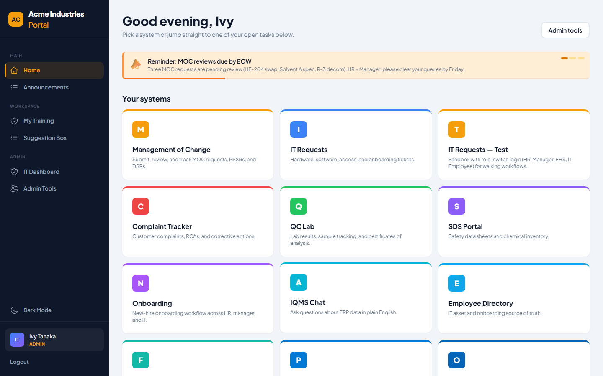<br/>**Portal** — app tiles, announcements, single sign-on | 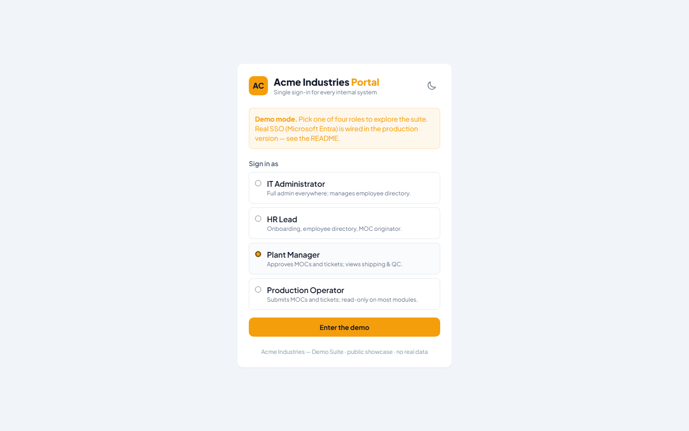<br/>**Portal login** — demo role picker |
| 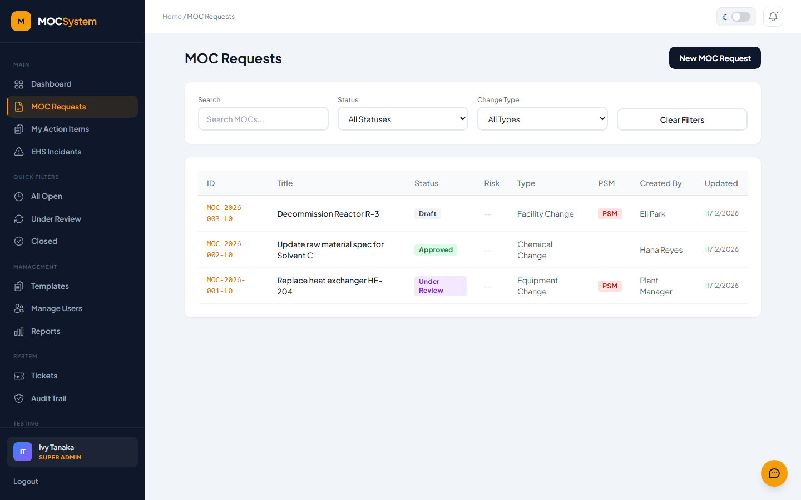<br/>**Management of Change** — change requests by status | 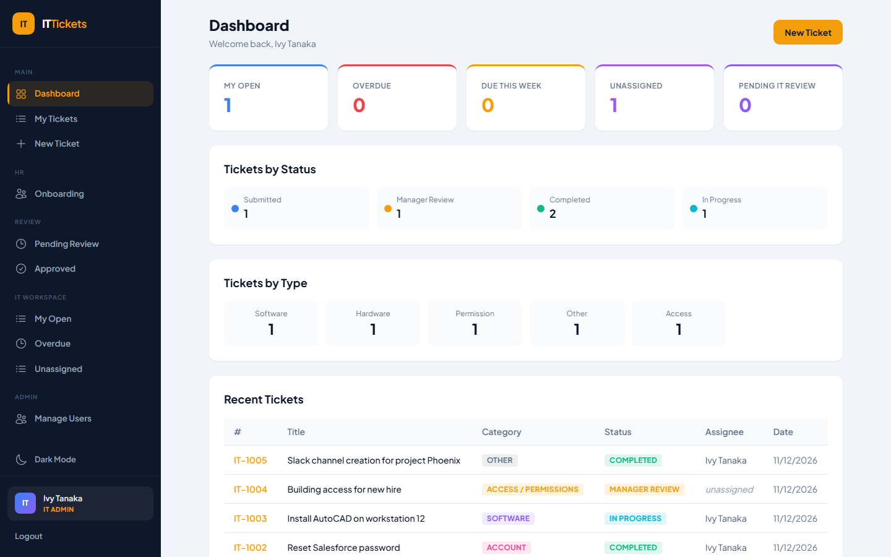<br/>**IT Request** — ticket dashboard |
| 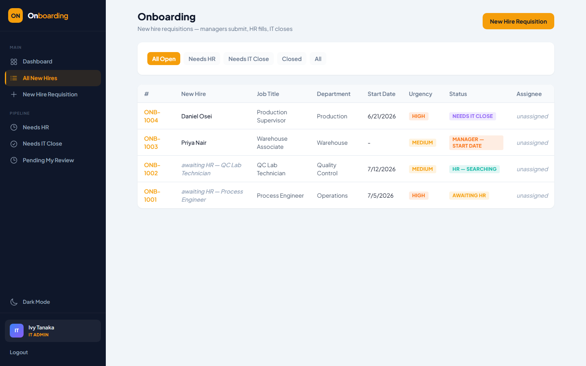<br/>**Onboarding** — new-hire requisition pipeline | 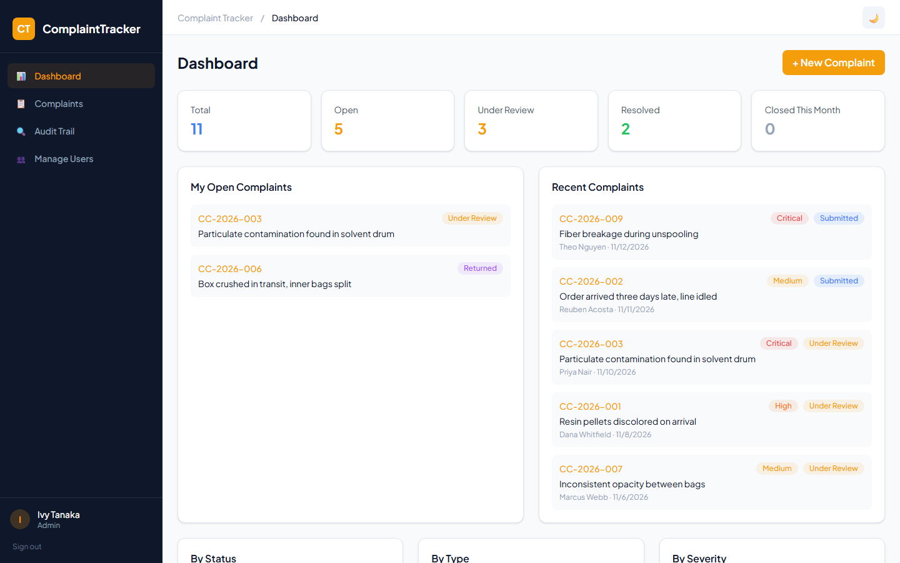<br/>**Complaint Tracker** — dashboard |
| 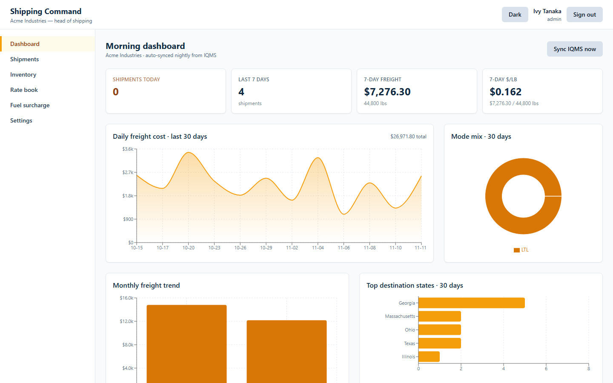<br/>**Shipping Command** — freight-cost dashboard | 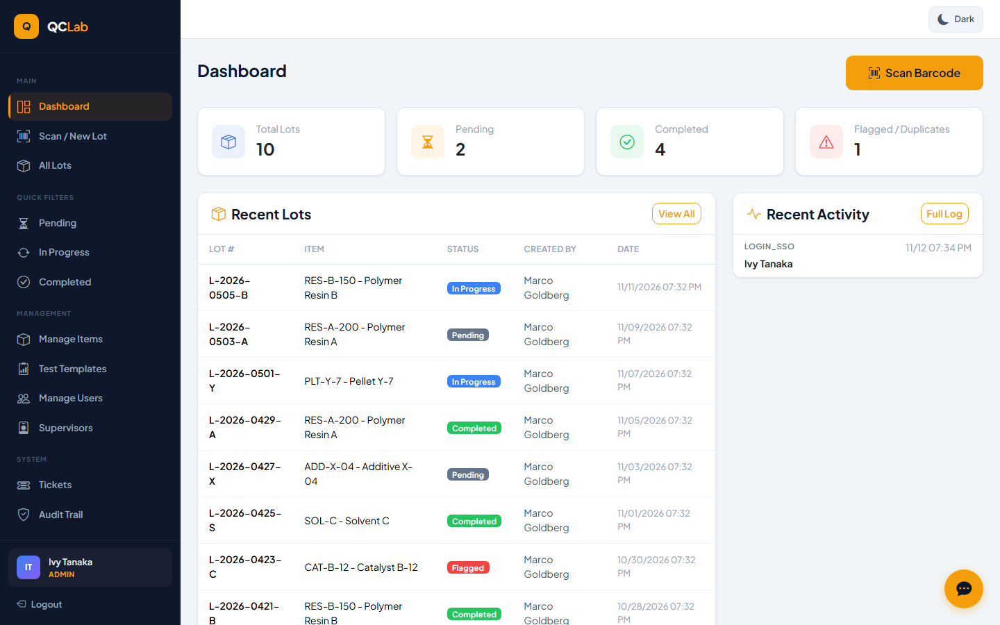<br/>**QC Lab** — lots and test status |
| 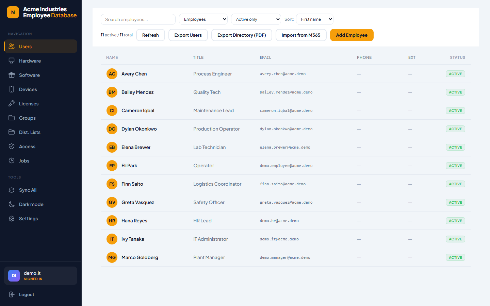<br/>**Employee Directory** — employees and assets | 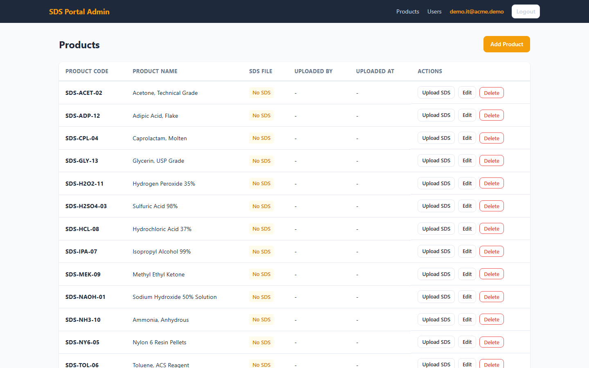<br/>**SDS Portal** — safety data sheet library |
| 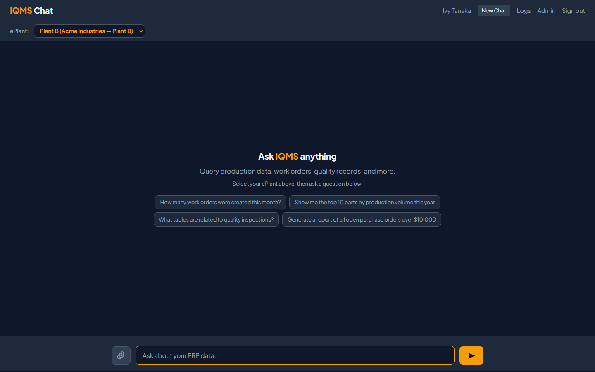<br/>**IQMS Chat** — natural-language ERP questions (canned answers in the demo) | |

## The apps

| App | What it does | Stack |
|---|---|---|
| **Portal** | Landing page and SSO bridge: app tiles per user, announcements, suggestion box, tasks aggregated from the other apps | Next.js 15, Express, PostgreSQL |
| **Management of Change** | Change-request workflow for process safety: 5x5 risk matrix, multi-department review, pre-startup safety review checklists, audit trail | Next.js 15, Express, PostgreSQL |
| **IT Request** | IT ticketing for hardware, software and access requests with manager review, IT review and resolution | Next.js 15, Express, PostgreSQL |
| **Onboarding** | New-hire requisitions: the hiring manager specifies needs, HR confirms identity details, IT fulfils | Next.js 15, Express, PostgreSQL |
| **Complaint Tracker** | Customer complaint tracking with attachments, dashboard and audit log | Next.js 15, Express, PostgreSQL |
| **Shipping Command** | Freight-cost dashboard: shipments, carrier rate book, fuel surcharge, lane routing, inventory | Next.js 15, Express, PostgreSQL |
| **QC Lab** | Quality-control lab: items, lots, test templates, test entry, kiosk view, audit log | Flask, Jinja, SQLite |
| **SDS Portal** | Safety Data Sheet library: products, SDS uploads and viewing | Flask, Jinja, SQLite |
| **Employee Directory** | IT system of record for employees, hardware assets, subscriptions, groups, onboarding/offboarding checklists and exports | Flask, React (Vite), SQLite |
| **IQMS Chat** | Natural-language chat over ERP data. Production sends questions to an LLM with read-only ERP query tools; the demo returns canned answers | Flask |

## Architecture

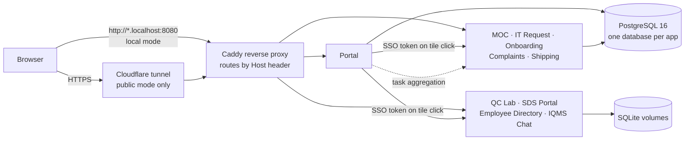

- **One container per app.** Each Node app runs its Next.js client and Express
  API in the same container; Caddy sends `/api/*` to the API port and
  everything else to the client. Flask apps listen on a single port.
- **Only Caddy is published** on the host (`HTTP_PORT`, default 8080). Apps,
  PostgreSQL and SQLite volumes stay on the internal Compose network.
- **Single sign-on.** When a user clicks a tile, the portal mints a 5-minute
  JWT (HS256, signed with `PORTAL_SSO_SECRET`, audience pinned to the target
  app) and redirects to that app's `/sso` endpoint. The app verifies the token,
  creates the user on first login, and issues its own session. There are no
  cross-app cookies.
- **Self-seeding.** Each container runs its migrations and an idempotent demo
  seed on start, so wiping the volumes returns the suite to a clean state.

## Quick start (localhost)

Requires Docker with Compose v2. No domain, DNS or tunnel is needed.

```bash
git clone https://github.com/Neuron89/business-suite-demo.git
cd business-suite-demo
docker compose --env-file local.env up -d --build
```

`bash install.sh --local` does the same and waits for the proxy to answer. The
first build compiles six Next.js apps and takes several minutes.

Then open **http://localhost:8080**, pick a role, and click a tile.

| App | Local URL |
|---|---|
| Portal | http://localhost:8080 |
| Management of Change | http://moc.localhost:8080 |
| IT Request | http://it.localhost:8080 |
| Onboarding | http://onboarding.localhost:8080 |
| Complaint Tracker | http://complaints.localhost:8080 |
| Shipping Command | http://ship.localhost:8080 |
| QC Lab | http://qc.localhost:8080 |
| SDS Portal | http://sds.localhost:8080 |
| Employee Directory | http://dir.localhost:8080 |
| IQMS Chat | http://chat.localhost:8080 |

Chrome, Edge and Firefox resolve `*.localhost` to the local machine
automatically. For other clients, add the hostnames above to your hosts file.

Stop, or stop and wipe all data:

```bash
docker compose --env-file local.env down
docker compose --env-file local.env down -v
```

## Self-hosting on a domain

The public mode serves the portal at `https://<DEMO_DOMAIN>` and each app on a
subdomain, published through a Cloudflare tunnel (no inbound ports opened).

```bash
bash install.sh        # first run writes .env from .env.example, then stops
nano .env              # set DEMO_DOMAIN, CLOUDFLARE_TUNNEL_TOKEN, and the secrets
bash install.sh        # builds and starts everything, including the tunnel
```

DNS and tunnel setup, the smoke test, and the nightly data-reset timer are
covered in **[deploy/SELF-HOSTING.md](deploy/SELF-HOSTING.md)**.

## Demo users

The portal login is a role picker rather than real SSO. Each role is a seeded
fictional employee that exists in every app.

| Role | Demo user | What they can do |
|---|---|---|
| IT | `demo.it@acme.demo` | Administrator everywhere; works IT tickets; manages the employee directory |
| HR | `demo.hr@acme.demo` | Onboarding-focused; administrator in MOC and the Employee Directory |
| Manager | `demo.manager@acme.demo` | Approves MOCs and tickets; views the shipping and QC dashboards |
| Employee | `demo.employee@acme.demo` | Submits MOCs and IT tickets; read-only on most modules |

## Configuration

Settings come from `local.env` (localhost) or `.env` (self-hosted, created from
`.env.example`). Everything has a default in `docker-compose.yml`.

| Variable | Purpose | Default |
|---|---|---|
| `DEMO_DOMAIN` | Base domain; portal at the apex, apps at `<sub>.<DEMO_DOMAIN>` | set per mode |
| `DEMO_SCHEME` | Scheme used in browser-facing SSO redirect URLs | `https` (`http` in `local.env`) |
| `DEMO_PORT_SUFFIX` | Optional `:port` appended to browser-facing URLs | empty (`:8080` in `local.env`) |
| `HTTP_PORT` | Host port the Caddy proxy listens on | `8080` |
| `CLOUDFLARE_TUNNEL_TOKEN` | Tunnel token; only needed for the public `tunnel` profile | empty |
| `PORTAL_SSO_SECRET` | Shared secret that signs and verifies cross-app SSO tokens | demo value; change when public |
| `JWT_SECRET` | Portal session token secret | demo value |
| `JWT_SECRET_<APP>` / `JWT_REFRESH_SECRET_<APP>` | Per-app token secrets for `MOC`, `IT`, `SHIPPING`, `COMPLAINT`, `ONBOARDING` | demo values |

## What is stubbed in the demo

| Production integration | Demo behaviour |
|---|---|
| Microsoft Entra ID sign-in | Replaced by the four-role picker on the portal login page |
| Outbound email (SMTP) | Not configured; notification emails are skipped or logged |
| Oracle ERP sync (Shipping) | Not run; the app reads seeded shipment and inventory tables |
| LLM + ERP query tools (IQMS Chat) | Canned answers keyed on words such as "production", "lots", "shipments", "inventory" |
| Active Directory / Microsoft 365 / door-access sync (Employee Directory) | No credentials configured and the sync scheduler is disabled; seeded data only |

The production code paths remain in the repository so the structure of each
integration can be read.

## Project structure

```
business-suite-demo/
├── docker-compose.yml       all services: postgres, caddy, cloudflared (optional), 10 apps
├── local.env                settings for localhost mode
├── .env.example             settings template for a public deployment
├── install.sh               installer for both modes
├── docker/
│   ├── Caddyfile            host-based routing to each app
│   └── postgres/init.sql    creates one database per Node app
├── deploy/
│   ├── SELF-HOSTING.md      Cloudflare DNS/tunnel walkthrough
│   ├── reset.sh             wipe volumes and re-seed
│   └── acme-demo-reset.*    systemd service + timer for a nightly reset
├── docs/screenshots/        README images
└── apps/
    ├── portal/              Next.js + Express
    ├── moc/                 Next.js + Express
    ├── it-request/          Next.js + Express
    ├── onboarding-system/   Next.js + Express
    ├── complaint-tracker/   Next.js + Express
    ├── shipping/            Next.js + Express
    ├── qc-lab/              Flask + SQLite
    ├── sds-portal/          Flask + SQLite
    ├── employee-directory/  Flask + React (Vite) + SQLite
    └── iqms-chat/           Flask
```

Each Node app is an npm-workspaces monorepo (`packages/shared`, `server`,
`client`) with Knex migrations and a demo seed under `server/src/db/`.

## License

MIT. See [LICENSE](LICENSE).
